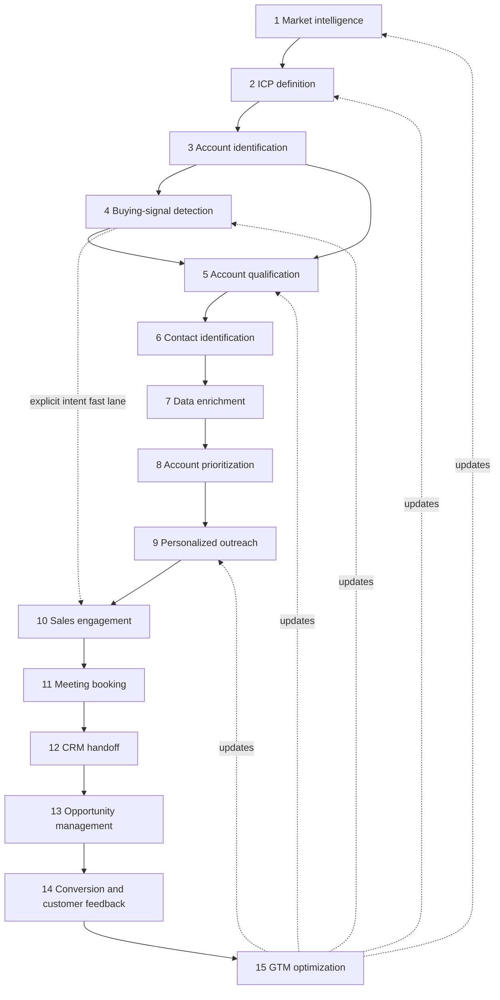

# GTM System Map: Owner-Led Multi-Outlet Businesses

**Owner:** Go-to-Market Engineering | **Audience:** GTM, Sales and leadership | **Version:** 2026-W46
Companion: [revenue-system-architecture.md](revenue-system-architecture.md) (data model, tools, controls, build plan).
Built on: [research](../../context/docs/research/source-register.md), [ICP](../../context/icp/ideal-customer-profile.md), [buying committee](../../context/icp/buying-committee.md), [qualification framework](../../context/icp/icp-qualification-framework.md), [signal matrix](../../context/docs/research/signal-matrix.md) and [signal scoring framework](../../context/docs/research/signal-scoring-framework.md).

> **Note on placement.** `knowledge-base/` is meant for reusable methods. This map follows that rule in its structure (the 15 stages work for any segment), but the details are filled in for Hubtel's selected segment. Where a stage is segment-specific, it says so.

## Summary

This map describes how Hubtel would move from market knowledge to a signed customer for one segment: **owner-led hospitality and food-service businesses with 2 to 15 outlets in Greater Accra** (secondary: multi-branch retail). It has 15 stages. Each stage has an owner, inputs, outputs, a quality check and a status. Data moves forward through defined handoffs, and results move back to improve earlier stages.

**Where we are today.** Stages 1, 2, 4 and 5 are documented. Stages 3, 6, 7, 8 and 15 are designed but not built or tested. Stages 9 to 14 are not built. They depend on three things not yet in place: positioning and messaging (P5), a chosen CRM, and Hubtel-side confirmation of product capabilities, pricing and the customer suppression list.

| Status | Meaning |
|---|---|
| **Documented** | Written in this project. Not yet tested on real accounts |
| **Designed** | Defined here. Needs build and test |
| **Not built** | Blocked on a dependency named in the stage |

## System at a glance

Two shortcuts exist by design:
- **Fast lane.** Explicit intent (signal matrix SG-16 to SG-18) goes from stage 4 straight to a human at stage 10, after gates and suppression checks.
- **Return paths.** Stages 10 to 14 send outcomes back to stage 15, which updates stages 1, 2, 4, 5 and 9.

## How data moves

Each arrow is a handoff with a defined payload. A stage must not pass an account forward unless the required fields are filled.

| From | To | Payload (required fields) | Held back if |
|---|---|---|---|
| 1 Market intelligence | 2 ICP | Findings, confidence levels, open gaps | Source not registered |
| 2 ICP | 3 Account identification | Segment, geography, outlet range, exclusions, gate list | Scope decisions not recorded |
| 3 Account identification | 5 Qualification | Business name, location, outlet count (with confidence), source URL, date | No source URL, or on the suppression list |
| 3 / 5 | 4 Signal detection | Account ID, name variants, social and listing URLs | Business not matched to a real entity |
| 4 Signal detection | 5 Qualification | Signal log rows (ID, date, source, verification level, points) | Signal unverified or name collision |
| 5 Qualification | 6 Contact identification | Gate results, fit score, pain score, capability check result, status | Status is Excluded, Not now, or capability on hold |
| 6 Contact identification | 7 Enrichment | Role candidates (owner, GM, finance lead), source, date | No business-role contact found |
| 7 Enrichment | 8 Prioritization | Verified contact channel, buyer role, completeness flags | Contact not verified, or data-protection check not passed |
| 8 Prioritization | 9 Outreach | Ranked list, angle, lead signal, proof allowed | No allowed angle or no approved copy |
| 9 Outreach | 10 Sales engagement | Message sent, channel, reply, timestamp | n/a |
| 10 Sales engagement | 11 Meeting booking | Interest confirmed, buyer role, stated pain | No stated need |
| 11 Meeting booking | 12 CRM handoff | Meeting date, attendees, pain notes, signal history | Missing pain notes |
| 12 CRM handoff | 13 Opportunity management | Account, contact, opportunity record, owner | Duplicate record |
| 13 Opportunity management | 14 Conversion and feedback | Outcome (won, lost, stalled), reason, product fit notes | Reason not recorded |
| 14 Conversion and feedback | 15 Optimization | Outcomes by signal, channel, angle and score band | n/a |

## Stage map

Format for each stage: purpose, inputs, activities, outputs, owner, tools, quality check, metric, status.

### 1. Market intelligence

- **Purpose:** know the company, market, competitors and customers, and how sure we are.
- **Inputs:** public sources, Hubtel's own pages and case studies, internal knowledge from Product, Commercial and Customer Success.
- **Activities:** research, source register, confidence ratings, correction log, conflict tracking.
- **Outputs:** the five research files in `context/docs/research/`.
- **Owner:** GTM Engineering.
- **Tools:** web research, Git, Notion for sharing finished docs.
- **Quality check:** every figure has a source and an access date. Conflicts are logged, not hidden.
- **Metric:** share of cited figures that are verified, not just claimed.
- **Status:** **Documented.** Confidence is mostly low to medium. Internal confirmation from Hubtel teams is the next improvement: pricing, product capabilities, customer lists.

### 2. ICP definition

- **Purpose:** decide who to target and who to avoid.
- **Inputs:** stage 1 outputs.
- **Activities:** segment selection, ICP attributes, buying committee, exclusions.
- **Outputs:** `ideal-customer-profile.md`, `buying-committee.md`.
- **Owner:** GTM Engineering, with Sales and leadership sign-off.
- **Quality check:** each attribute is labelled as evidence or assumption.
- **Metric:** share of won deals that match the ICP (needs deal data).
- **Status:** **Documented.** Primary: owner-led hospitality and food service, 2 to 15 outlets, Greater Accra. Secondary: multi-branch retail.

### 3. Account identification

- **Purpose:** build the list of businesses that could fit.
- **Inputs:** ICP, exclusion rules, suppression list (Hubtel's existing customers).
- **Activities:** collect businesses from candidate sources (business registries, tourism and hospitality lists, map listings, social pages, directories); deduplicate; record outlet count and a confidence level.
- **Outputs:** an account list with source URL and date per row.
- **Owner:** GTM Engineering.
- **Tools (today):** spreadsheet. Candidate sources are untested.
- **Quality check:** test sources on 20 accounts first. Check for duplicates, closures and chains with different owners.
- **Metric:** accounts found per source; share confirmed as real and in scope.
- **Status:** **Designed.** Needs a source test.

### 4. Buying-signal detection

- **Purpose:** find businesses showing signs of change or pain.
- **Inputs:** account list, signal matrix (SG-01 to SG-20).
- **Activities:** scan sources, log signals, verify, check for false positives, apply recency and verification multipliers.
- **Outputs:** signal log rows and Signal Score per account.
- **Owner:** GTM Engineering.
- **Quality check:** each signal has a source, a date, a verification level and a false-positive check.
- **Metric:** signals found per account; false-positive rate.
- **Status:** **Documented.** Strengths and data-source coverage are untested.

### 5. Account qualification

- **Purpose:** decide whether an account deserves research and outreach.
- **Inputs:** account data, signal log, gates G1 to G8, fit score, capability check.
- **Activities:** apply gates; score fit (0 to 40), pain (0 to 30), triggers (0 to 20), contactability (0 to 10); run the capability check with Product's confirmed list.
- **Outputs:** status: Qualified, Research, Not now, Excluded.
- **Owner:** GTM Engineering, with a human reviewer.
- **Quality check:** human review of the first 20 accounts. Compare scored and human decisions.
- **Metric:** share of Qualified accounts that a human agrees with.
- **Status:** **Documented.** Weights are uncalibrated.

### 6. Contact identification

- **Purpose:** find the right person in each qualified account.
- **Inputs:** Qualified and Research-now accounts; buying committee roles.
- **Activities:** identify the owner or MD, general manager, finance or operations lead; note which role to approach first (test owner for small groups, finance or operations lead for larger ones).
- **Outputs:** one primary and one secondary contact per account, with role and source.
- **Owner:** GTM Engineering.
- **Tools (today):** LinkedIn and business pages by hand. treg is deferred and unpaid.
- **Quality check:** the contact is a business role, reachable through a business channel. No private personal data beyond what outreach needs.
- **Metric:** share of qualified accounts with a verified decision-maker.
- **Status:** **Designed.**

### 7. Data enrichment

- **Purpose:** fill the fields needed for prioritisation and outreach.
- **Inputs:** accounts, contacts.
- **Activities:** confirm outlet count, payment channels, staff handling money, current provider, social and listing URLs, contact channel (email, phone, WhatsApp business, LinkedIn); record source and date for each field.
- **Outputs:** an enriched account record with completeness flags.
- **Owner:** GTM Engineering.
- **Quality check:** every field has a source and date; unknown stays unknown.
- **Metric:** field completeness; share of contact channels that work.
- **Status:** **Designed.** Depends on the data-protection review.

### 8. Account prioritization

- **Purpose:** order the work so effort goes to the best accounts.
- **Inputs:** enriched, qualified accounts.
- **Activities:** rank by total score (fit, pain, trigger, contactability). Within the same band, rank by recency of the strongest signal, then by pattern (scaling and straining before growth without pain).
- **Outputs:** a weekly ranked list, and a weekly batch size set by capacity.
- **Owner:** GTM Engineering, approved by Sales.
- **Quality check:** a human approves each batch before outreach.
- **Metric:** reply and meeting rate by score band.
- **Status:** **Designed.**

### 9. Personalized outreach

- **Purpose:** start a relevant conversation, tied to the observed signal.
- **Inputs:** ranked batch, signal and angle, approved messaging and facts file.
- **Activities:** choose the angle from the signal card; write the first message with one verifiable reference to the account; send through approved channels.
- **Outputs:** sent messages with channel, date and the angle used.
- **Owner:** GTM Engineering drafts; Sales sends or approves.
- **Quality check:** claims limited to documented capabilities and attributed to Hubtel; no unverified numbers; no named customers without permission; no em dashes; human approves.
- **Metric:** reply rate by angle and signal type.
- **Status:** **Not built.** Needs positioning and messaging (P5), a facts file and approved copy (P9).

### 10. Sales engagement

- **Purpose:** turn replies into qualified conversations.
- **Inputs:** replies, explicit-intent leads from the fast lane.
- **Activities:** respond within the target time, ask discovery questions about current payments and settlement, confirm role and pain, check capability fit, record notes.
- **Outputs:** discovery notes against the buying committee model; interest confirmed or declined.
- **Owner:** Sales.
- **Quality check:** no promises about branch dashboards, per-staff tracking, automated reconciliation, audit logs or pricing unless confirmed.
- **Metric:** time to first response; share of replies with a stated pain.
- **Status:** **Not built.**

### 11. Meeting booking

- **Purpose:** secure a discovery or demo meeting with the right people.
- **Inputs:** interested contacts.
- **Activities:** propose slots, confirm attendees (owner plus finance or operations lead where possible), send a short agenda, record signal history for the meeting owner.
- **Outputs:** booked meeting with attendees and pain notes.
- **Owner:** Sales.
- **Quality check:** the buyer's stated need is in the invite notes.
- **Metric:** meetings booked per 100 contacted; show rate.
- **Status:** **Not built.**

### 12. CRM handoff

- **Purpose:** move the account from the outbound system to the sales pipeline without losing context.
- **Inputs:** meeting, signal history, qualification record, contact record.
- **Activities:** create or update the account, contact and opportunity; attach signals, scores and notes; assign an owner; deduplicate against existing customers.
- **Outputs:** an opportunity record with full history.
- **Owner:** GTM Engineering and Sales Ops.
- **Tools:** CRM not yet chosen. Confirm with Sales which CRM they use.
- **Quality check:** no duplicate accounts; required fields filled.
- **Metric:** share of handoffs with complete records.
- **Status:** **Not built.** The CRM decision blocks it.

### 13. Opportunity management

- **Purpose:** run the deal to a decision.
- **Inputs:** opportunity record.
- **Activities:** demo, proposal, pricing, onboarding discussion, internal buyer alignment (owner, finance lead, staff adoption plan); log objections.
- **Outputs:** won, lost or stalled, with reasons.
- **Owner:** Sales.
- **Quality check:** a reason is recorded for every outcome.
- **Metric:** stage conversion, cycle time, objection frequency.
- **Status:** **Not built.** Pricing and sales motion are not public. Confirm with Commercial.

### 14. Conversion and customer feedback

- **Purpose:** learn from outcomes and early customer experience.
- **Inputs:** won and lost deals; onboarding feedback; early usage.
- **Activities:** capture win and loss reasons; interview a few customers about what triggered the purchase and what they use; ask permission for named references; feed capability gaps to Product.
- **Outputs:** outcome data by signal, angle and channel; case study candidates; product feedback.
- **Owner:** Sales, Customer Success, GTM Engineering.
- **Quality check:** feedback is recorded in structured fields, not only notes.
- **Metric:** win rate by ICP fit and signal pattern; time to first value.
- **Status:** **Not built.**

### 15. GTM optimization

- **Purpose:** improve the system using results.
- **Inputs:** outcome data from stage 14, signal logs, reply data.
- **Activities:** monthly review; recalibrate weights, gates and thresholds; retire signals that do not predict outcomes; update ICP and messaging; record learnings.
- **Outputs:** updated documents; entries in `knowledge-base/learnings/`; a change log.
- **Owner:** GTM Engineering, reviewed with Sales and leadership.
- **Quality check:** every change is linked to data and recorded.
- **Metric:** improvement in reply rate, meeting rate and win rate per score band.
- **Status:** **Designed.**

## Feedback loops

| Result observed | Stage to change | Example |
|---|---|---|
| Qualified accounts rarely reply | 4, 5, 9 | Signal weights too high, or the angle is wrong |
| Replies mention a pain we did not score | 4, 2 | Add a signal or revise the ICP pains |
| Meetings booked, no deals | 5, 10, 13 | Qualification too loose, or capability gap |
| Won deals share a signal we ignore | 4 | Raise its base points |
| Lost deals cite capability gaps | Product, 5 | Add to capability check, raise with Product |
| Source finds mostly false positives | 3, 4 | Drop or replace the source |

## Dependencies before the system can run end to end

| Dependency | Needed by stage | Owner | Status |
|---|---|---|---|
| Hubtel customer list for suppression | 3, 5 | Commercial | Not requested |
| Product confirmation of branch, staff, reconciliation and audit capabilities | 5, 9, 10 | Product | Not requested |
| Pricing and sales motion | 10, 13 | Commercial | Not public |
| Positioning, messaging and facts file | 9 | GTM Engineering | Not started (P5) |
| Outbound workflow and copy | 9 | GTM Engineering | Not started (P8, P9) |
| CRM choice and set-up | 12, 13 | Sales Ops | Not decided |
| Data-protection review | 3, 6, 7, 9 | Legal | Not requested |
| Source test on 20 accounts | 3, 4 | GTM Engineering | Not run |

## Confidence

- Stage structure and handoffs: medium.
- Owner and tool assignments: low (we do not know Hubtel's current Sales team structure and CRM).
- Metrics: no benchmarks exist. Targets will be set after the first batch.

## Next steps

1. Request the dependency items above.
2. Run the source test (stage 3) and the signal test (stage 4) on 20 accounts.
3. Draft positioning and messaging (P5), then the outbound workflow (P8).
