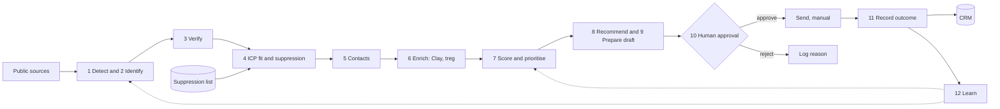

# Workflow Architecture: New-Outlet Payments Setup

**Owner:** Go-to-Market Engineering | **Audience:** GTM, Sales and technical reviewers | **Version:** 2026-W46 | **Status:** Design. Nothing is built or activated.
Related: [workflow-spec.md](workflow-spec.md) | [data-schema.md](data-schema.md) | [qualification-rules.md](qualification-rules.md) | [revenue system architecture](../../knowledge-base/playbooks/revenue-system-architecture.md) | [tool register](../../tools/tool-integration-register.md)

## 1. Summary

The workflow is built in layers. **Phase 0 is a spreadsheet and a person.** Later phases swap each manual step for a tool only after the manual step is proven. The target design uses five parts:

| Part | Role |
|---|---|
| **Clay** | Research and enrichment tables for accounts and contacts |
| **n8n** | Orchestration: schedules, routing, scoring calls, approvals, error handling |
| **treg** | Paid access to third-party data endpoints, called through n8n or Clay, with a spend cap |
| **CRM** | The system of record for accounts, contacts, activity and opportunities |
| **Claude Code** | Documentation, scoring code, tests, prompts and reviews. It does not run live outreach |

**Status today.** Only Claude Code, Git, Notion and Miro are in use. treg is prepared but not installed or funded (see [treg-setup.md](../../tools/treg-setup.md)). Clay needs an account we do not have. n8n is not installed. We do not know Hubtel's CRM. None of these should be bought or connected before the phase 0 pilot proves the signals exist.

## 2. Architecture diagram

```
                         HUMAN CONTROL POINTS
              HA1 sources     HA2 qualify     HA3 messages    HA4 spend
                  |               |               |               |
  SOURCES         v               v               v               v
 +-----------+   +-----------+   +-----------+   +-----------+   +-----------+
 | Public    |-->| 1 DETECT  |-->| 3 VERIFY  |-->| 4 ICP FIT |-->| 5 CONTACTS|
 | pages,    |   | 2 IDENTIFY|   | signal    |   | gates +   |   | roles     |
 | listings, |   | + dedupe  |   | 2 sources |   | suppress  |   | from      |
 | press,    |   +-----------+   +-----------+   +-----------+   | public    |
 | jobs      |         |                                |        +-----------+
 +-----------+         v                                v              |
                +--------------+                 +-------------+      v
 +-----------+  | ACCOUNT TABLE|<----------------| SUPPRESSION |  +-----------+
 | Hubtel    |->| (sheet, then |                 | LIST        |  | 6 ENRICH  |
 | customer  |  | Clay + CRM)  |                 +-------------+  | Clay,     |
 | list      |  +--------------+                                  | treg      |
 +-----------+         ^                                          +-----------+
                       |                                                |
                       |        +-------------------------------+       v
                       +--------| 7 SCORE + PRIORITISE          |<------+
                                | rules in qualification-rules  |
                                +-------------------------------+
                                              |
                                              v
                                +-------------------------------+
                                | 8 RECOMMEND  9 PREPARE        |
                                | angle, proof, sequence DRAFT  |
                                +-------------------------------+
                                              |
                                              v
                                +-------------------------------+
                                | 10 HUMAN APPROVAL (HA3)       |---> reject: log reason
                                +-------------------------------+
                                              | approve
                                              v
                                +-------------------------------+
                                | SEND (manual in phase 0-2)    |
                                +-------------------------------+
                                              |
                                              v
                                +-------------------------------+      +-----------+
                                | 11 RECORD OUTCOME             |----->| CRM       |
                                | reply, meeting, decline       |      | (record)  |
                                +-------------------------------+      +-----------+
                                              |
                                              v
                                +-------------------------------+
                                | 12 LEARN: weekly review,      |
                                | recalibrate, change log       |-----> back to 1, 3, 7, 8
                                +-------------------------------+
```

A text diagram is used because it renders everywhere. The same flow in Mermaid:



## 3. Build phases

Each phase ends with a test. Do not start a phase until the one before it has passed.

| Phase | What changes | Tools | Cost | Exit test |
|---|---|---|---|---|
| **0 Manual pilot** | Run steps 1 to 12 by hand on 20 accounts. Spreadsheet follows [data-schema.md](data-schema.md) | Sheet, browser, Claude Code | Staff time only | Reviewer agrees with the scored statuses. Signals found for most accounts |
| **1 CRM recording** | Outcomes and approved accounts are recorded in the CRM | The CRM Hubtel already uses, if any | Unknown | Complete records for every handoff |
| **2 Clay research and enrichment** | Account and contact enrichment move into a Clay table | Clay | Needs a plan and a budget decision | Enrichment accuracy at least as good as manual on the same 20 accounts |
| **3 n8n orchestration** | Scheduling, routing, scoring, approvals and error handling run automatically up to the approval step | n8n | Hosting or subscription cost unknown | The scored list matches manual scoring on a test batch. Errors are logged. Nothing sends |
| **4 treg paid data** | Selected paid endpoints fill gaps Clay does not cover | treg | Prepaid, billed per call | One test record, then a capped batch. Cost per verified field recorded |
| **5 Controlled sending** | After approval, the approved sequence is sent through a permitted tool with limits | To be decided | Unknown | Opt-out, limit and audit tests pass. Needs separate approval |

**Why this order.** The CRM comes first because a handoff is needed in any case and Hubtel may already pay for one. Clay comes before n8n so we know what data to move. n8n comes before treg so the spend cap and error handling exist before money is spent. Sending is last and needs its own approval.

## 4. Tool roles

### 4.1 Clay: prospect research and enrichment

Use Clay as a working table with one row per account, and a second table for contacts.

| Use | Detail |
|---|---|
| Accounts table | Imports the verified account list. Adds website, social links, and any firmographics Clay's providers return |
| Contacts table | Role candidates (owner, GM, finance lead) linked to the account by `account_id` |
| Research columns | AI-assisted columns that read a business page and fill outlet count, payment methods mentioned and a one-line evidence note. Each column returns evidence text and a URL, never only a conclusion |
| Verification columns | Flag rows where the AI answer has no supporting URL |
| Output | A table exported or pushed to n8n and the CRM |

**Risks and tests.**
- Clay's data coverage for small Ghanaian businesses is **unknown** and may be thin. Test on 20 accounts before paying.
- AI research columns can be wrong. Keep human verification of every signal.
- Credit use depends on the plan and actions. Check the plan before running at scale.
- We have no Clay account, and the imported Clay tools (`tools/rex`) are not installed or approved. Do not run them.

### 4.2 n8n: automation and orchestration

n8n moves data between steps and enforces the rules. It does not decide qualification. The rules live in code or a config file that is versioned in Git.

| Workflow | Trigger | Nodes (outline) |
|---|---|---|
| **W1 Intake** | Weekly schedule, or manual form | Read candidate rows, dedupe against accounts, check the suppression list, create or update the account, write a run-log row |
| **W2 Verify and score** | New or updated account | Fetch signals, apply gates, calculate scores using the rules, set status, write the qualification row |
| **W3 Enrich** | Status is Research now or Qualified | Call the Clay webhook or API (per plan), call treg only if HA4 allows and the spend cap is not met, write enrichment back |
| **W4 Recommend** | Status is Qualified or approved override | Select the angle from the rule table, attach allowed proof, create the recommendation card and the draft sequence for review |
| **W5 Approval** | New recommendation | Notify the reviewer (email or chat), wait for a decision, record approve, edit or reject |
| **W6 Outcome** | Reply, meeting or decline logged | Update the CRM and the outcome table, set recheck dates |
| **W7 Weekly digest** | Weekly schedule | Summarise counts, errors, spend and outcomes for the review |
| **WE Error handler** | Any failure | Log, stop the run, alert the owner, do not continue to approval |

**Design rules.**
- Fail closed. If a check errors, the account does not progress.
- One run-log row per run, with counts and cost.
- Credentials stored in n8n's credential store or `.env`, never in workflow JSON or Git. Document names only.
- Workflow exports (JSON) are versioned in `tools/` after removing secrets, so changes can be reviewed.
- No sending node exists until phase 5 is approved. W5 ends at the approval record.
- Check n8n's licence terms and hosting options before choosing between self-hosting and a hosted plan. Costs are unknown.

### 4.3 treg: paid data-provider access

treg gives one account and one token for a catalog of third-party data endpoints, billed per call from a prepaid balance (vendor claims from its own site, recorded in [treg-setup.md](../../tools/treg-setup.md)).

| Use | Rule |
|---|---|
| Candidate uses | Contact enrichment and buying-signal data not covered by Clay, where an endpoint covers Ghana |
| Entry rule | Search the catalog and record price, reliability and coverage. Run one test record. Only then a capped batch |
| Spend control | Approved cap per run and per week (HA4). n8n counts calls and stops at the cap |
| Output | Every paid result is stored with provider, call cost, date and the field it filled |
| Secret handling | The token stays in `TREG_TOKEN` or the `.treg` config, never in documents or committed files |
| Status | Prepared, not installed, not funded. No price or balance has been seen |

**Unknown:** whether any provider covers small Ghanaian hospitality businesses or business-role contacts. If none do, treg adds no value to this segment. Test before funding.

### 4.4 CRM: recording and managing prospects

| Use | Detail |
|---|---|
| System of record | Accounts, contacts, activities, opportunities |
| Fields | Added from [data-schema.md](data-schema.md): status, scores, signal summary, buyer role, outreach angle, approval, outcome |
| Records written by | n8n for automated fields; people for conversation notes |
| Duplicate control | Match on `account_id`, then name plus city plus URL |
| Suppression | The customer list and opt-outs are CRM data, read by W1 |
| Reporting | Funnel by status, angle, channel and score band |

**First task:** find out which CRM Sales uses, who administers it and whether custom fields can be added. Until then, the sheet is the record.

### 4.5 Claude Code: documentation and development

| Use | Detail |
|---|---|
| Documentation | Specs, schemas, rules, playbooks, work log, decision records |
| Development | Scoring functions, validators, n8n expressions, test cases, CSV import and export scripts |
| Prompts | Writes and tests the prompt templates used in Clay columns, with examples of correct and incorrect outputs |
| Review | Reviews diffs and workflow exports before use, checks for secrets and rule violations |
| Testing | Builds a small set of test accounts (hypothetical, labelled) to check the rules produce the expected status |
| Limits | Does not send outreach, spend money or publish without human approval. Does not hold secrets |

## 5. Step to tool map

| Step | Phase 0 | Target |
|---|---|---|
| 1 Detect | Weekly manual scan | Alerts and permitted tools feeding n8n W1 |
| 2 Identify | Manual dedupe in sheet | n8n W1 dedupe plus CRM match |
| 3 Verify | Manual, two sources | Clay verification columns plus human check |
| 4 ICP fit | Sheet formulas | n8n W2 using versioned rules |
| 5 Decision-makers | Manual LinkedIn and page review | Clay contacts table, treg where covered |
| 6 Enrich | Manual | Clay, then treg |
| 7 Score | Sheet formulas | n8n W2 (or a script called by n8n) |
| 8 Recommend | Rule table by hand | n8n W4 |
| 9 Prepare sequence | Drafted with Claude Code, from the facts file | n8n W4 attaches approved templates |
| 10 Approval | Reviewer marks the sheet | n8n W5 |
| 11 Record outcome | Manual | n8n W6 to CRM |
| 12 Learn | Weekly meeting and note | n8n W7 digest plus the same meeting |

## 6. Data flow between components

| From | To | Data | Trigger |
|---|---|---|---|
| Sources | Intake | Candidate business, URL, date | Weekly scan |
| Intake | Account table | Account row | Dedupe pass |
| Account table | Scoring | Account, signals, contacts | Status change |
| Suppression list | Intake and scoring | Customer IDs and opt-outs | Every run |
| Scoring | Clay | Accounts needing enrichment | Status Research now or better |
| Clay and treg | Account table | Enrichment fields with source and cost | On completion |
| Scoring | Recommendation | Status, lead signal, capability check | Qualified |
| Recommendation | Reviewer | Card and draft sequence | New card |
| Reviewer | Account table | Approval record | Decision |
| Outcome | CRM | Reply, meeting, decline, notes | Logged |
| Outcome | Learning | Outcomes by signal, angle, channel | Weekly |

## 7. Controls

| Control | Where | Rule |
|---|---|---|
| Suppression | W1 and W2 | Run on every account at every run |
| Fail closed | All | Errors stop progress |
| Spend cap | W3 | Per run and per week, set before the run |
| Approval | W5 | HA3 required, no bypass |
| Audit | All | Every status change, spend and approval has a timestamp and a name |
| Secrets | All | Environment names only in docs. Values never in Git |
| Rate limits | Future sending | Per day and per account limits set in advance |
| Rollback | Rules and workflows | Versioned in Git. Revert by restoring the last version |

## 8. Cost drivers

No prices are assumed. Record real figures here once known.

| Driver | Where | How to control it |
|---|---|---|
| Staff time | Phase 0 | Fixed time slots. Batch size limit |
| Clay plan and credits | Phase 2 | Test on 20 accounts. Check credits per action first |
| n8n hosting or plan | Phase 3 | Decide hosting after the pilot |
| treg calls | Phase 4 | One test record. Prepaid cap |
| CRM seats and fields | Phase 1 | Use the existing CRM first |
| Sending tool | Phase 5 | Decide after the pilot |

## 9. Developer skills needed

A developing GTM engineer can build phases 0 to 3 with these skills:
- Spreadsheet formulas, lookups and data validation.
- Reading and writing JSON.
- Basic n8n: triggers, HTTP requests, IF and Code nodes, error workflows.
- Basic Git: commit workflow exports and rules, review diffs.
- Prompt writing with evidence requirements.
- Working with an API key safely.

Claude Code can draft the rules, formulas, test cases and workflow outlines. A human reviews and approves each.

## 10. Risks

| Risk | Impact | Mitigation |
|---|---|---|
| Tools bought before signals are proven | Wasted spend | Phase gates |
| Clay and treg do not cover Ghanaian SMEs | Paid tools add little | One-record and 20-account tests |
| AI research columns hallucinate | Wrong signals | Evidence URL required. Human check |
| Automation scales a bad rule | Wrong outreach | Phase 0 calibration. Weekly review |
| Secrets leak | Account compromise | `.env`, credential stores, secret scans before every commit |
| Platform terms breach | Account bans, reputational harm | No scraping of forbidden sites. Manual or permitted tools |
| CRM not available or not extensible | No system of record | Sheet remains the record. Clarify early |
| Orchestration complexity | Unmaintainable | One workflow per step group. Exports versioned |

## 11. Confidence

- Architecture and phases: medium.
- Tool fit (Clay, n8n, treg): low to medium. We have not used any of them in this project, and coverage and costs are unknown.
- CRM: low. We do not know which one Hubtel uses.

## 12. Next steps

1. Create the sheet from [data-schema.md](data-schema.md).
2. Request the suppression list, capability list and CRM details.
3. Run phase 0 on 20 accounts.
4. Decide on Phase 1 to 4 purchases after reviewing the pilot.
